# NVKE Telemetry Pipeline

[](https://dsx-ai-factory.github.io/nvke-telemetry-pipeline/overview)

NVKE Telemetry Pipeline (NKTP) is a scalable, OpenTelemetry pipeline for collecting, processing, and exporting Kubernetes metrics, logs, and traces, with sensible defaults and flexible, shareable configuration.

## Quickstart

You need access to a Kubernetes cluster running **1.31 or later**, with
`kubectl` and **Helm 3** configured to use it. Choose a Helm release
[compatible with your Kubernetes version](https://helm.sh/docs/v3/topics/version_skew/).

The cluster needs **cert-manager**, a default **StorageClass** that provisions
persistent volumes, and the Kubernetes resource metrics API (`metrics.k8s.io`).
Review the [full prerequisites](nktp/README.md#prerequisites), including network
access and storage performance. Default installation requires capacity for
resource requests rounded up to **5 CPU / 14 GiB for shared components**, plus
**1 CPU / 2 GiB for each node**, at minimum replica counts. Allow extra headroom
for cluster services, prerequisites, unrequested LGTM resources, and autoscaling.

If the cluster has no metrics API provider, add `--set metrics-server.enabled=true`
to the install command. Replace `my-cluster` with your cluster name.

```bash
helm repo add nvidia https://helm.ngc.nvidia.com/nvidia
helm repo update nvidia

kubectl create namespace nktp
kubectl label namespace nktp pod-security.kubernetes.io/enforce=privileged

helm install nktp nvidia/nktp \
  --version 0.1.0 \
  --namespace nktp \
  --set global.clusterName=my-cluster \
  --wait
```

After installation, repeat these checks until every Collector's `READY` column
shows all expected replicas ready, such as `2/2`, and every certificate reports
`READY=True`:

```bash
kubectl -n nktp get opentelemetrycollector
kubectl -n nktp get certificate
```

The bundled LGTM backend is **for evaluation only**. Data is in memory and
Grafana allows anonymous admin access. Once ready, forward Grafana to localhost
and open <http://127.0.0.1:3000>:

```bash
kubectl -n nktp port-forward svc/lgtm 3000:3000 --address 127.0.0.1
```

For production, [configure your backend and disable bundled LGTM](docs/getting-started.md#set-a-backend).
See the [getting-started guide](docs/getting-started.md) for troubleshooting.

## Documentation

If your workloads run on a cluster with NKTP, read
[Send telemetry to NKTP](docs/guides/send_telemetry.md).

If you install and operate NKTP, start with the [chart README](nktp/README.md)
for prerequisites and installation, or the
[getting-started guide](docs/getting-started.md) for backend configuration and
a first look at your telemetry. The [documentation index](docs/README.md)
covers components and configuration guides.

To pass your own blueprints to NKTP, see
[Add your own blueprints](docs/guides/use_blueprints.md#add-your-own-blueprints).

See the [release process](RELEASING.md) for how chart changes are validated and released.

To contribute, start with [CONTRIBUTING.md](CONTRIBUTING.md); see [GOVERNANCE.md](GOVERNANCE.md) for how decisions are made and [MAINTAINERS.md](MAINTAINERS.md) for who maintains the project. Report security issues through [SECURITY.md](SECURITY.md), not GitHub issues.

NVKE Telemetry Pipeline is licensed under the [Apache License 2.0](LICENSE).

**NOTICE AND DISCLAIMER:** This software automatically retrieves, accesses or
interacts with external materials. Those retrieved materials are not distributed
with this software and are governed solely by separate terms, conditions and
licenses. You are solely responsible for finding, reviewing and complying with
all applicable terms, conditions, and licenses, and for verifying the security,
integrity and suitability of any retrieved materials for your specific use case.
This software is provided "AS IS", without warranty of any kind. The author
makes no representations or warranties regarding any retrieved materials, and
assumes no liability for any losses, damages, liabilities or legal consequences
from your use or inability to use this software or any retrieved materials. Use
this software and the retrieved materials at your own risk.
