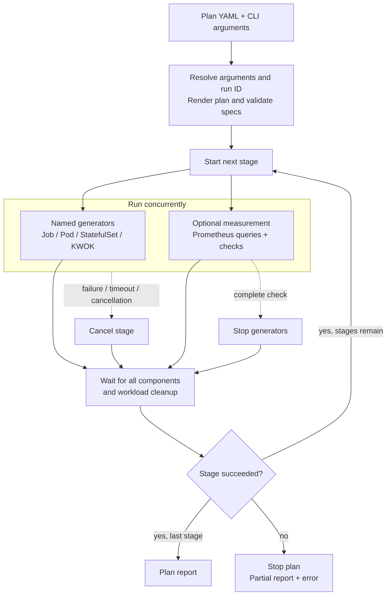

# Scale framework reference

## Framework overview

Plans configure generators and measurements. Helm values configure the installed
environment. See [setup and workloads](README.md) to run a plan.



## Annotated plan

Illustrative excerpt: replace both `{}` Pod templates with the matching `small`
and `large` templates in the [stdout-logs plan](examples/stdout-logs/plan.yaml).
Those templates label Pods with `{{ .Args.runId }}`. The
[stdout-logs setup](examples/stdout-logs/README.md) installs the ConfigMaps and
scrape configuration that expose that label as `test_run_id`.

```yaml
name: stdout-overview
timeout: 8m                       # Shared deadline across all stages.
stages:                           # Sequential. Each stage cleans up before the next.
  - name: baseline                 # Observation-only: generators may be omitted.
    measurement:
      type: prometheus
      spec:
        endpoint: http://127.0.0.1:9090
        duration: 30s
        interval: 15s
        measurements:
          - name: gateway_memory
            units: bytes
            # Pipeline-wide observation. Includes other runs and background traffic.
            query: otelcol_process_memory_rss_bytes{job="nktp-gateway-logs"}

  - name: load
    generators:                   # Both generators and the measurement run together.
      - name: small
        type: statefulset
        spec:
          count: 1                # One StatefulSet, containing one Pod.
          replicas: 1
          duration: 5m            # Longer than the 3m completion deadline below.
          podTemplate: {}         # Replace with the small template linked above.
      - name: large
        type: statefulset
        spec:
          count: 1
          replicas: 1
          duration: 5m
          podTemplate: {}         # Replace with the large template linked above.
    measurement:                  # One observer containing multiple named entries.
      type: prometheus
      spec:
        endpoint: http://127.0.0.1:9090
        duration: 3m              # Fail if the completion target is not reached.
        interval: 15s             # Poll immediately, then on 15s ticker events.
        query_timeout: 10s        # Limit each Prometheus request.
        measurements:
          - name: producer_rate
            units: records/s
            # This run only. Queries record observations without setting thresholds.
            query: |-
              sum by (scale_bucket) (
                rate(vector_component_sent_events_total{
                  component_id="stdout_load",test_run_id="{{ .Args.runId }}"
                }[1m])
              )
          - name: gateway_unavailable
            check:
              action: fail        # Default action. Cancels peers and stops the plan.
              for: 30s            # The same labels must match throughout the hold.
              # Pipeline-wide. Also fail when the gateway target disappears.
              expr: |-
                (up{job="nktp-gateway-logs"} == 0)
                or absent(up{job="nktp-gateway-logs"})
          - name: producers_active
            check:
              action: complete    # Stop generators, await cleanup, finish this stage.
              for: 30s            # Failure still takes precedence over completion.
              # Both producers must emit and have a sample less than 30s old.
              # Adjust 2 if count/replicas change. This checks production, not delivery.
              # Filtering comparisons (no bool) produce one matching series or none.
              expr: |-
                count(
                  (rate(vector_component_sent_events_total{
                    component_id="stdout_load",test_run_id="{{ .Args.runId }}"
                  }[1m]) > 0)
                  and (time() - timestamp(vector_component_sent_events_total{
                    component_id="stdout_load",test_run_id="{{ .Args.runId }}"
                  }) < 30)
                ) == 2
```

## Plans and stages

| Field | Meaning |
| --- | --- |
| `name` | Nonempty plan name |
| `timeout` | Positive execution deadline, including workload startup and recovery |
| `stages` | Nonempty list executed in declaration order |
| `stages[].name` | Nonempty, unique stage name |
| `stages[].generators` | Parallel generators, each with a unique `name`, `type` and `spec` |
| `stages[].measurement` | Optional observer with a `type` and `spec` |

Omit `measurement` for load-only stages or `generators` for observation-only
stages. At least one must be present. Plan and component specs are validated
before execution. Kubernetes validates native workload fields on creation.

## Generators

| Type | Configuration in `spec` | Normal completion |
| --- | --- | --- |
| `job` | `podTemplate`, optional `count`, `parallelism`, `completions`, `context` | Every Job completes. Failed Jobs are not retried |
| `pod` | `podTemplate`, optional `count` | Every Pod succeeds. Pods are not replaced |
| `statefulset` | `podTemplate`, positive `duration`, optional `count`, `replicas` | Every set finishes its duration and is Ready |
| `kubernetes` | Positive `duration`, named `nodeGroups` with `replicas` and `nodeTemplate` | All KWOK nodes become Ready and remain for the duration |

| Setting | Meaning / default |
| --- | --- |
| `podTemplate` | Native Kubernetes PodTemplateSpec: namespace/labels in `metadata`. Containers, resources, volumes, scheduling and probes in `spec` |
| Namespace | Defaults to `default`. Must already exist |
| Ownership | Generated names and `scale.nktp.io/generator` labels are reserved for the runner |
| Job/Pod/StatefulSet `count` | Workload objects per generator. Default `1`, accepts `0`. Objects run concurrently |
| Job `parallelism` / `completions` | Positive Pods in parallel / total completions. Default `1` / `parallelism` |
| StatefulSet `replicas` | Pods per set. Default `1`, accepts `0`. Independent of `count` |
| Pod lifecycle | Jobs default to `restartPolicy: Never`. Standalone Pods must exit successfully. StatefulSets require long-lived containers with `Always` |
| KWOK node groups | Unique `name`, positive `replicas` (default `1000`), native `nodeTemplate`. Allocatable defaults to `status.capacity` |
| Cluster | Generators use the plan's kubeconfig. Job `context` can select another context in that file |

KWOK simulates nodes and Pod lifecycles without running containers. The
[KWOK example](examples/kwok/README.md) combines node and Pod generators.

## Arguments and attribution

| Input | Use |
| --- | --- |
| `-plan PATH` | Required plan file. Prefer an absolute path |
| `-arg NAME=VALUE` | Repeat after `--` in `task scale:test`. Reference as `{{ .Args.name }}` in the plan |
| Hyphenated arguments | `sample-rate` becomes `.Args.sampleRate`. Missing referenced arguments and duplicate normalized names fail |
| `-arg run-id=example-123` | Supplies `.Args.runId`. Omitted IDs are generated and printed in the report |
| Run ID format | 1–63 ASCII letters, digits, underscores, hyphens or dots. First and last characters must be letters or digits |
| Run attribution | Put the ID in emitted attributes / scrape labels **and** query filters. It does not filter pipeline-wide metrics automatically |
| Template quoting | Plans use Go `text/template`. Quote string references and escape supplied values for YAML and PromQL |
| Literal template text | Write `{{ "{{ .Args.name }}" }}` to emit `{{ .Args.name }}` |

See [run a workload](README.md#run-a-workload) for kubeconfig selection, path
resolution and the outer Go test timeout.

## Prometheus measurements

| Field in `measurement.spec` | Meaning / default |
| --- | --- |
| `endpoint` | HTTP(S) Prometheus base URL reachable from the test host |
| `duration` | Positive collection window starting with the stage. Maximum wait when a completion check exists |
| `interval` | Positive interval. Poll immediately, then on 15-second ticker events by default. Slow query rounds may skip ticks |
| `query_timeout` | Positive timeout per query. Default `10s` |
| `measurements` | Nonempty list. Each entry has a unique `name` and exactly one of `query` or `check` |
| Entry `units` | Optional display units. `bytes` and `bytes/s` scale automatically |

| Entry | Behavior |
| --- | --- |
| `query: <PromQL>` | Collect observations. No performance threshold. Request/evaluation errors fail the plan except cancellation caused by measurement expiry. That request is omitted. An unconfirmed completion check still fails the stage |
| `check.expr` | Instant-vector PromQL. Every returned series matches, including a zero-valued sample. Use filtering comparisons without `bool` |
| `check.for` | Hold for the same labels across consecutive evaluations. Default immediate. Must be shorter than `duration` |
| `check.action: fail` | Default action. Any matching series that satisfies the hold fails the plan |
| `check.action: complete` | At most one per measurement. Must match one finite float series with stable labels. Stops generators and advances after cleanup |
| Backend warnings | Fail the plan for check expressions. Ordinary queries retain warnings without failing |
| Empty check result | Resets pending holds. Does not fire. Use `absent(...)` when missing telemetry should fail |
| Freshness | PromQL lookback can include earlier stages. Scope to the intended run/load and check sample timestamps for completion |

## Timing and cleanup

| Event / deadline | Effect |
| --- | --- |
| Ordinary measurement expiry | Ends observation. Generators keep running. Stage waits for all components |
| Completion target reached | Requests generator shutdown. Stage waits for all components and cleanup |
| Completion target unmet at `duration` | Fails the stage |
| Generator exits before required target | Fails the stage even if the generator succeeded. Keep generators running longer than the measurement window |
| Component error, failure check, plan timeout or caller cancellation | Cancels peers. Stops the plan. Retains partial findings. Failures take precedence over completion |
| StatefulSet `duration` | Starts when all replicas first become Ready. Pod replacement does not restart it. Plan timeout also bounds scheduling/recovery |
| Cleanup | Generators remove owned resources after success, failure, partial startup or cancellation. Cleanup has its own bounded timeout and errors fail the run |
| `TEST_TIMEOUT` | Outer Go test limit. Allow time beyond the plan timeout for cleanup |
| Installed environment | Persists between plans. Remove it using [shared cleanup](README.md#cleanup) |

## Reports

| Output | Contents |
| --- | --- |
| Plan | Plan name, run ID and started stages in declaration order |
| Stage | Named generator outcomes, measurement results and errors, including cleanup failures |
| Query | Per-series statistics and histograms. Missing samples, warnings and errors shown separately |
| Check | Expression, hold duration, attempts and firing status. Firing time and matching series appear when fired. `Action: complete` appears for completion checks, whether or not they fire |

The command prints reports even when execution fails. Execution errors fail the
test. Successful workload execution alone does not verify backend delivery.
